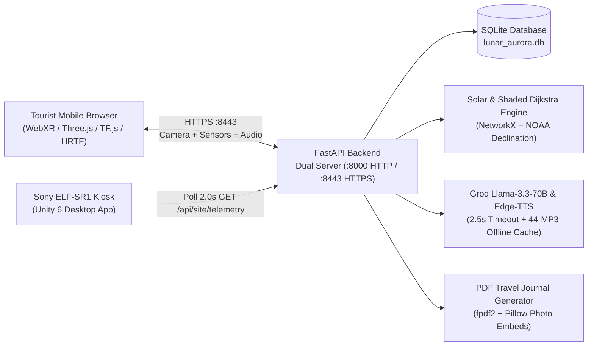

# System Architecture & Technical Design

**Lunar Aurora** coordinates two synchronized spatial frontends (**Mobile WebXR** and **Sony ELF-SR1 Unity 6 Kiosk**) over a fast asynchronous **FastAPI** backend with SQLite/PostGIS-ready persistence.

## High-Level Architecture

## Repository Structure (`/src` & `/docs`)
- `src/backend/`: FastAPI routers (`chat`, `routing`, `vision`, `scavenger`, `site`, `ticket`, `session`, `tour`), SQLAlchemy entities, Edge-TTS/Groq failover services, `init_db.py`, `pre_cache_audio.py`, `test_suite.py`, `benchmark_kpis.py`.
- `src/frontend_webxr/`: Camera-first AR interface (`index.html`), `arScene.js` (`.glb` + Era Slider + `DeviceOrientationEvent` HRTF listener + corner 3D Guide), `visionEngine.js` (6-class carving signature matcher), `shadeMap.js` (Red sun vs. Green shaded SVG map), `locationTracker.js` (GPS + `?demo=1` Jury Table Demo Mode), `tourManager.js`, `spatialAudio.js`.
- `src/kiosk_unity/`: Unity 6 project targeting Windows x64 Sony Spatial Reality Display (ELF-SR1), containing `SRDisplayViewerController.cs`, `HolographicMonumentPreview.cs`, `KioskNetworkBridge.cs`, `KioskUIManager.cs`, and `BuildScript.cs`.
- `docs/`: Mandatory partner & accelerator docs (`ax.md`, `oss_attribution.md`), architecture/domain guides, and 5 printable Mahabalipuram matte carving cards.

## Core API Endpoints
- `POST /api/ticket/create` & `GET /ticket`: Counter portal issuing URL-encoded QR mobile session tickets in `EN`, `TA`, or `HI`.
- `POST /api/session/start`, `/advance`, `/end`, `/riddle`: Full state persistence across reloads/phone calls, plus `+45 XP` historical stop riddles.
- `GET /api/site/telemetry`: Returns both `shortest_path` (sun glare route) and `shaded_path` (colonnade/banyan route), `heat_exposure_saved_pct`, solar angles, and live `active_visitor_nodes`.
- `POST /api/vision/identify`: Matches scanned Mahabalipuram carving classes (`shore_temple_vimana`, `chariot_wheel`, `yali_pillar`, `nataraja_relief`, `lotus_basin`) and returns bilingual/cached audio + scavenger unlocks.
- `POST /api/tour/{session_id}/photo` & `/journal`: Captures watermarked camera+AR snapshots and compiles a downloadable multi-page PDF Travel Journal.
