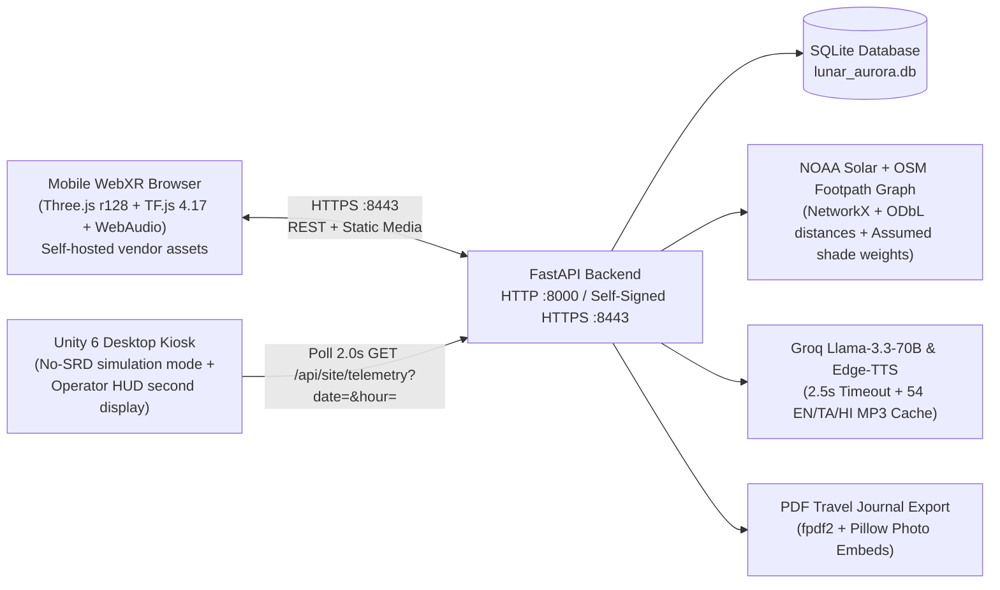

# System Architecture & Technical Design

**Lunar Aurora** connects a **Mobile WebXR companion** (`src/frontend_webxr/`) and a **Unity 6 desktop kiosk** (`src/kiosk_unity/`) to an offline-resilient **FastAPI + SQLite** backend (`src/backend/`).

## High-Level Architecture

## Directory Layout
- `src/backend/`:
  - `app/main.py` & `app/models/entities.py`: FastAPI setup, zero-CDN static mounts, SQLAlchemy models storing `source`, `coordinate_source`, and `distance_source`.
  - `app/routers/site.py`: Exposes `GET /api/site/nodes`, `/edges`, `/overview` (including dynamic `available_class_models` detection for verified `<class_id>.glb` files on disk), and `/telemetry`.
  - `app/services/routing_service.py`: Full **NOAA General Solar Position Equations** (`date` default `2027-01-11`, `hour`, lat `12.6165° N`, lon `80.19° E`) + NetworkX Dijkstra dual-path solver over OpenStreetMap walking distances and **assumed/illustrative** canopy shade weights (`not measured sun exposure`).
  - `app/services/groq_service.py` & `app/services/tts_service.py`: `2.5s` async timeout with `OFFLINE_QA_BANK` and `54` pre-synthesized EN/TA/HI MP3s (`src/backend/static/audio_cache/`).
  - `app/services/vision_knowledge.py`: Sourced metadata for the 5 Mahabalipuram carving classes (`shore_temple_vimana`, `pancha_rathas`, `arjunas_penance`, `krishnas_butter_ball`, `mahishasuramardini_cave`); never guesses on empty/background labels.
  - `init_db.py`: Seeds 7 Mahabalipuram stops with OpenStreetMap ODbL coordinates, per-stop `arrival_radius_m` (`20, 45, 75, 25, 25, 25, 30` — marked `UNVERIFIED until field-tested`), 13 OSM walkway distances (`4128.3 m` / `4.13 km` total **one-way trail**, `~59 min` at assumed `70.0 m/min` walking speed) with assumed shade factors (`0.10`–`0.94`), and Wikipedia/UNESCO source URLs.
  - `train_classifier.py` & `requirements-train.txt`: MobileNetV2 pipeline with held-out session split and post-export TF.js accuracy verification (`<= 3` percentage-point gap gate; untrained until real `data/cards/` captures are recorded; see [`docs/training_guide.md`](training_guide.md)).
  - `generate_ssl_certs.py`, `test_suite.py`, `benchmark_kpis.py`.
- `src/frontend_webxr/`:
  - Locally vendored `three.min.js`, `GLTFLoader.js`, `DRACOLoader.js` + `draco/` WASM decoder, `tf.min.js`, `qrcode.min.js`, Font Awesome `6.5.1` (`src/frontend_webxr/vendor/`).
  - `js/visionEngine.js`: Reports `"Vision model not installed"` until `model.json` exists.
  - `js/shadeMap.js`, `js/locationTracker.js`, `js/tourManager.js`: OpenStreetMap metric `(x, y)` coordinates, API-loaded per-stop geofences, manual `"I'm here"` stop check-in (`POST /api/session/checkin`), dynamic SVG framing, NOAA date/hour controls, and explicit `"assumed weights"` disclosure.
  - `js/arScene.js` & `js/spatialAudio.js`: `Grand_Solstice_Sun_Temple.glb` hidden from WebXR UI & Demo Mode; renders `Photo + Facts` by default or loads optional `<class_id>.glb` (`docs/3d_model_spec.md`) labeled `"Model by Team Lunar Aurora - stylised"` / `"Not a survey-accurate reconstruction."`; `DeviceOrientationEvent` binaural panner alignment.
- `src/kiosk_unity/`:
  - Unity `6000.6.9f1` standalone Windows x64 project (`No-SRD simulation mode`; `SRDISPLAY_SDK_PRESENT` undefined).
  - Defaults to `3840x2160` `FullScreenWindow`, with CLI `-windowed` switch for development, `KioskNetworkBridge.cs` polling `/api/site/telemetry?date=...&hour=...`, and `Operator HUD (second display)`.
- `docs/`: Technical reports, `oss_attribution.md`, `known_limitations.md`, `training_guide.md`, `3d_model_spec.md`, `device_test_checklist.md`, `demo_script.md`, `sony_srd_integration_todo.md`, and A4 printable cards.

## Core API Endpoints
- `GET /ticket`, `GET /qr`, `POST /api/ticket/create`: QR ticketing in `EN`, `TA`, or `HI`.
- `POST /api/session/start`, `/advance`, `/end`, `/riddle`: Session persistence & `+45 XP` riddles.
- `GET /api/routing/solar-status?date=YYYY-MM-DD&hour=HH.H`: NOAA declination, equation of time, hour angle, solar elevation, azimuth.
- `GET /api/site/telemetry?start_id=1&target_id=7&date=YYYY-MM-DD&hour=HH.H`: Shortest vs. assumed-shade Dijkstra routes (OSM distances + assumed weights), NOAA geometry, active stop visitor counts.
- `POST /api/vision/identify`: Matches card class labels without guessing.
- `POST /api/tour/{session_id}/photo` & `/journal`: Watermarked AR snapshots + `fpdf2` PDF journals.

## Tooling Disclosure
Developed by Team Lunar Aurora with **Antigravity** used as an AI coding assistant during system debugging, refactoring, and verification.
