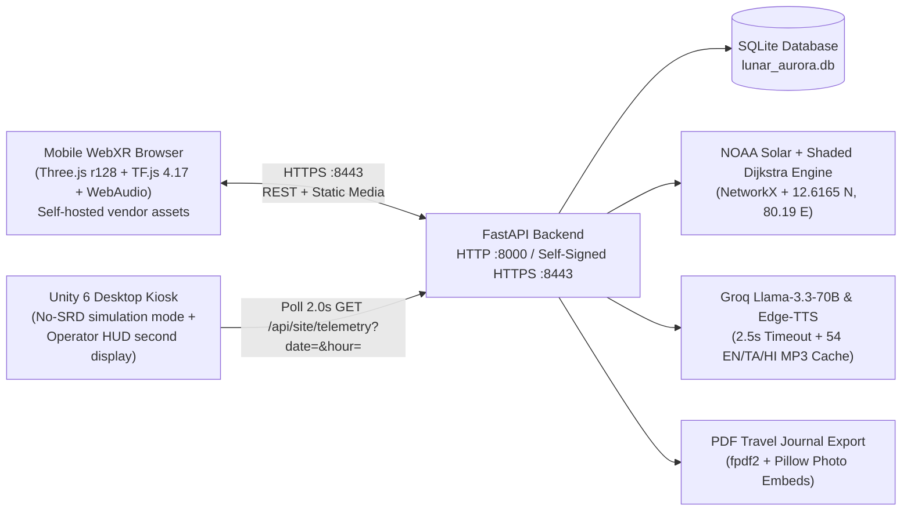

# System Architecture & Technical Design

**Lunar Aurora** connects a **Mobile WebXR companion** (`src/frontend_webxr/`) and a **Unity 6 desktop kiosk** (`src/kiosk_unity/`) to an offline-resilient **FastAPI + SQLite** backend (`src/backend/`).

## High-Level Architecture

## Directory Layout
- `src/backend/`:
  - `app/main.py`: FastAPI initialization, zero-CDN static mounts (`/app`, `/static`), CORS configuration.
  - `app/services/routing_service.py`: Full **NOAA General Solar Position Equations** (`date` default `2027-01-11`, `hour`, lat `12.6165° N`, lon `80.19° E`) + NetworkX Dijkstra dual-path solver producing `Heat Exposure Saved (%)` as an explicit **model estimate**.
  - `app/services/groq_service.py` & `app/services/tts_service.py`: `2.5s` async cloud timeout with `OFFLINE_QA_BANK` and `54` pre-synthesized EN/TA/HI MP3 files (`src/backend/static/audio_cache/`).
  - `app/services/vision_knowledge.py`: Sourced metadata for the 5 authentic Mahabalipuram carving classes (`shore_temple_vimana`, `pancha_rathas`, `arjunas_penance`, `krishnas_butter_ball`, `mahishasuramardini_cave`). Refuses to guess on empty/background labels (`unregistered_feature`).
  - `init_db.py`: Seeds 7 sourced Mahabalipuram stops, 13 site graph edges, 5 carving card artifacts, and 3 quests (every historical stop/artifact includes a Wikipedia/UNESCO `source` URL).
  - `train_classifier.py` & `requirements-train.txt`: MobileNetV2 (frozen ImageNet base, session-grouped train/val split, augmentation) TF.js export script (untrained until `data/cards/` video frames are recorded).
  - `generate_ssl_certs.py`: Generates self-signed TLS `cert.pem`/`key.pem` with automatic LAN IP + `localhost` SANs (with optional `--ip`).
  - `test_suite.py` & `benchmark_kpis.py`: Automated 9-group API/NOAA verification suite and 20-iteration benchmark generator.
- `src/frontend_webxr/`:
  - `vendor/`: Locally vendored `three.min.js` (`r128`), `GLTFLoader.js` (`r128`), `tf.min.js` (`4.17.0`), `qrcode.min.js` (`1.0.0`), and Font Awesome Free `6.5.1` CSS + 8 webfonts (zero CDN dependencies).
  - `js/visionEngine.js`: Strictly checks `/app/assets/vision_model/model.json` and `carving_signatures.json`; displays `"Vision model not installed"` if missing.
  - `js/shadeMap.js` & `js/tourManager.js`: Renders Shortest Sun vs. Shaded Canopy routes with NOAA date/hour inputs and `"model estimate"` labeling.
  - `js/arScene.js` & `js/spatialAudio.js`: Camera-first Three.js viewport (`Grand_Solstice_Sun_Temple.glb` labeled `"Illustrative model"` for Shore Temple only; cards 02–05 show verified Wikimedia photos + facts panels), plus `DeviceOrientationEvent` HRTF listener alignment.
- `src/kiosk_unity/`:
  - Unity `6000.6.9f1` standalone Windows x64 project currently running in **`No-SRD simulation mode`** (`SRDisplayUnityPlugin` is not installed; `SRDISPLAY_SDK_PRESENT` is not defined).
  - `KioskNetworkBridge.cs` polls `GET /api/site/telemetry?start_id=1&target_id=7&date=...&hour=...` and updates `HolographicMonumentPreview.cs` directional sun light from NOAA elevation/azimuth.
  - `KioskUIManager.cs` / `KioskOperatorDisplayHUD` renders **`Operator HUD (second display)`** on Display 1 when present.
- `tools/extract_frames.py`: Samples recorded phone card videos (`<class>__session_XX.mp4`) every `0.25s` into `data/cards/<class>/session_XX/` for training.
- `docs/`: Documentation, attribution (`oss_attribution.md`), Sony integration guide (`sony_srd_integration_todo.md`), and A4 printable carving cards (`carving_cards/print_5_carving_cards.html`).

## Core API Endpoints
- `GET /ticket`, `GET /qr`, `POST /api/ticket/create`: Offline QR ticketing counter issuing URL-encoded mobile URLs (`EN`, `TA`, `HI`).
- `POST /api/session/start`, `/advance`, `/end`, `/riddle`: SQLite-persisted session progression and sourced riddles (`+45 XP`).
- `GET /api/routing/solar-status?date=YYYY-MM-DD&hour=HH.H`: NOAA solar elevation, azimuth, declination, EoT, and hour angle (default date `2027-01-11`).
- `GET /api/site/telemetry?start_id=1&target_id=7&date=YYYY-MM-DD&hour=HH.H`: Dual Dijkstra routes, `heat_exposure_saved_pct` (model estimate), NOAA solar fields, and active stop visitor counts.
- `POST /api/vision/identify`: Matches scanned class labels (`shore_temple_vimana`, `pancha_rathas`, `arjunas_penance`, `krishnas_butter_ball`, `mahishasuramardini_cave`) with strict non-guessing behavior on empty/background labels.
- `POST /api/tour/{session_id}/photo` & `/journal`: Saves camera+AR captures locally and compiles downloadable `fpdf2` PDF journals.

## Tooling Disclosure
Developed by Team Lunar Aurora with **Antigravity** used as an AI coding assistant during system debugging, refactoring, and verification.
